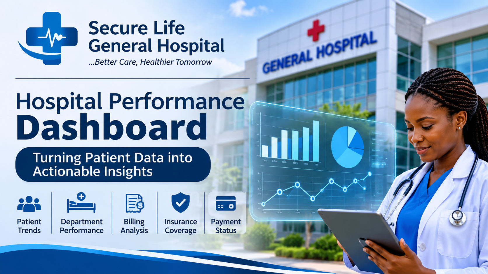
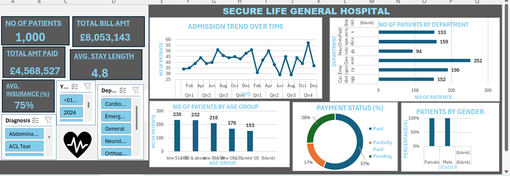

# SECURE HEALTH GENERAL HOSPITAL DASHBOARD

##INTRODUCTION

This data analytics project focuses on analysing hospital patient records to evaluate operational and financial performance.
Using Microsoft excel I developed an attractive interactive dashboard to monitor patient admission, departmental performance, medical billing, insurance coverage, payment status and patient demographics.
     The objective is to transform healthcare data into meaningful insights that support effective management decisions.
     
     ##ABOUT THE DATASET
     
The dataset contains hospital patient visit records covering demographics, admissions, diagnosis, billing, insurance coverage, and payment status. It supports analysis of hospital operations and financial performance.

##PROBLEM STATEMENT

The hospital lacks a consolidated system for monitoring patient admission, billing, insurance coverage and overall operational performance.

##DATA VISUALIZATION

Interactive charts and KPI cards showcase hospital performance and key trends.

##KEY INSIGHTS

1 Identify departments with the highest patient visits and bills
2 Monitor payment status and insurance coverage.
3 Track admission trends and patient demographics.
4 Highlight areas requiring management attention.

##RECOMMENDATIONS

Improve payment monitoring, strengthen insurance tracking, and optimize departmental resources to enhance hospital efficiency and financial performance.

##CONCLUSION

This project demonstrates how data analytics can transform hospital records into actionable insights, supporting better decision making and improved operational efficiency.

